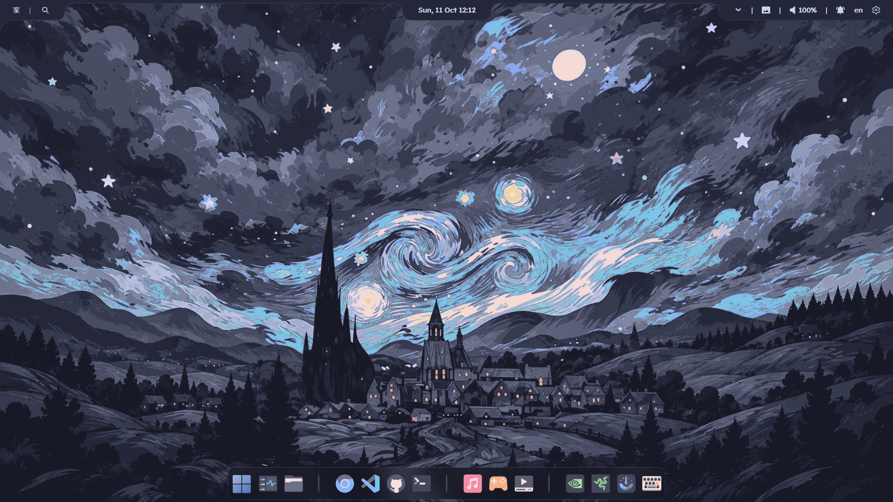
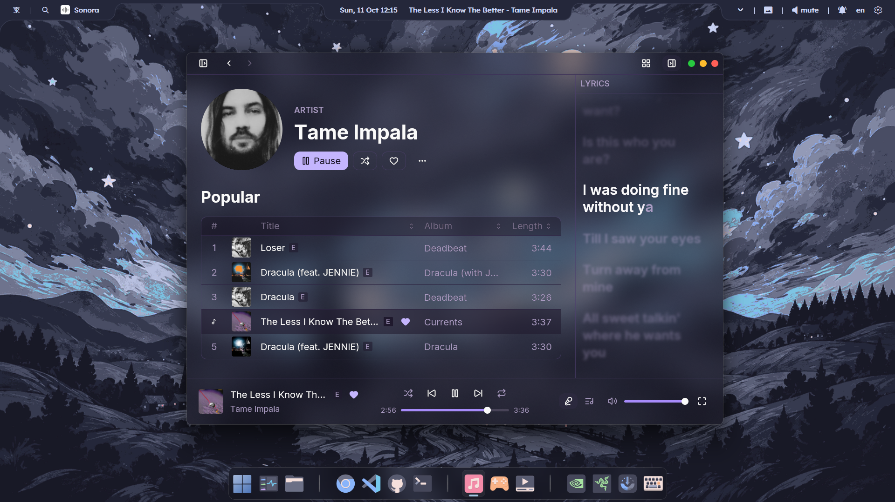
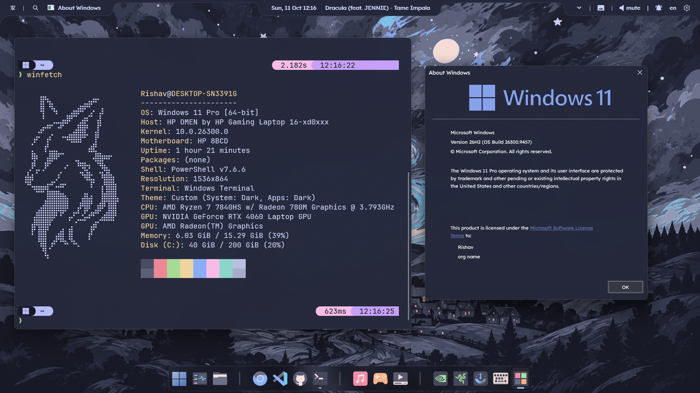
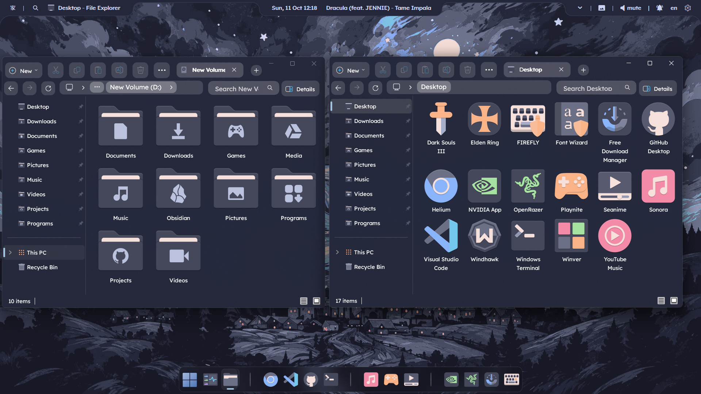
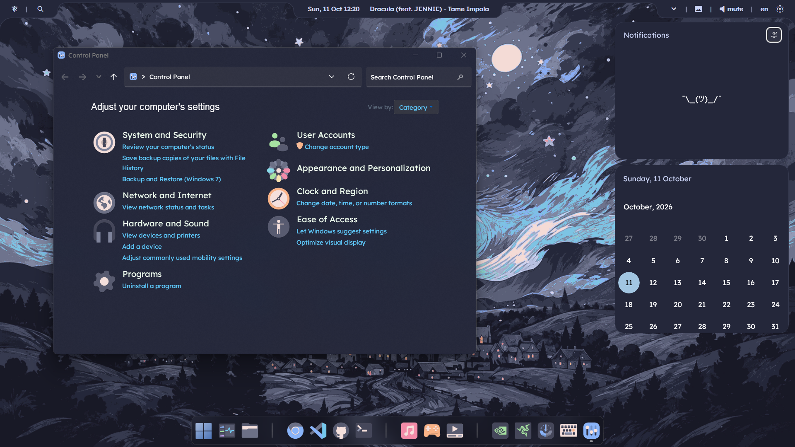
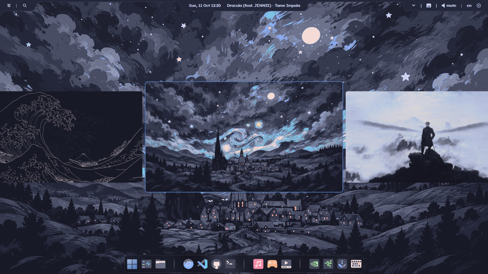

# 🌸 windots

<p align="center">
  
</p>

<h3 align="center">My personal Windows rice & dotfiles</h3>

<p align="center">
  A customized Windows setup inspired by Catppuccin Macchiato, featuring lavender accents, a minimal interface, and a cohesive desktop aesthetic.
</p>

<p align="center">
  <a href="https://www.reddit.com/r/desktops/s/hNWyjDnonO">
    
  </a>
  
  
</p>

---

## ✨ About

**windots** is my personal collection of Windows rice configurations, dotfiles, and customization tweaks, built around the beautiful [Catppuccin Macchiato](https://github.com/catppuccin/catppuccin) color palette.

The setup combines a dark, muted background with lavender accents, a customized Windows interface, and a consistent visual style across the desktop.

What started as personal desktop customization has turned into a setup I'm excited to share with others.

### 🔥 Featured on Reddit

Check out my desktop setup on r/desktops!

**[View my Reddit post →](https://www.reddit.com/r/desktops/s/hNWyjDnonO)**

The post reached the top posts of the week on r/desktops, with 400+ upvotes. Thanks to everyone who checked it out and shared their feedback!

## 🖼️ Screenshots

<p align="center">
  
  
</p>

<p align="center">
  
  
</p>

<p align="center">
  
  
</p>

<p align="center">
  
</p>

## 🎨 Color Palette

The setup uses **Catppuccin Macchiato**, with Lavender as the primary accent.

| Color | Hex | Usage |
|---|---|---|
| Base | `#24273a` | Main background |
| Mantle | `#1e2030` | Secondary backgrounds |
| Crust | `#181926` | Deep backgrounds |
| Surface 0 | `#363a4f` | UI surfaces |
| Surface 1 | `#494d64` | Borders and secondary elements |
| Surface 2 | `#5b6078` | Elevated surfaces |
| Text | `#cad3f5` | Primary text |
| Subtext 0 | `#a5adcb` | Secondary text |
| Subtext 1 | `#b8c0e0` | Muted text |
| Lavender | `#b7bdf8` | Primary accent |
| Blue | `#8aadf4` | Secondary accent |
| Mauve | `#c6a0f6` | Highlights |
| Pink | `#f5bde6` | Additional accents |
| Green | `#a6da95` | Success and status indicators |

## 📦 Installation

These are personal configurations rather than a universal installer.

1. Clone the repository:

   ```powershell
   git clone https://github.com/rishav12s/windots.git
   ```

2. Browse the configuration files and identify the components you want to use.
3. Install the corresponding applications and customization tools.
4. Apply each configuration according to its application's instructions.

> [!IMPORTANT]
> Back up your existing configurations before applying these files. Some modifications may depend on your Windows version, installed applications, or additional customization tools.

## 🛠️ Setup

| Component | Configuration |
|---|---|
| **Window Effects** | [Windhawk](https://windhawk.net/) — Translucent Windows with Catppuccin bg colors |
| **Taskbar** | [Windhawk](https://windhawk.net/) — Frosty Glass (Taskbar Styler), custom height and icon size, tray auto-hide on hover |
| **Icons** | [Catmocha Icon Theme](https://www.deviantart.com/digifeye/art/Catmocha-Icon-Theme-1261586793) via Windhawk Resource Redirect, with manually customized shortcut icons |
| **Taskbar Separators** | [TaskSeparator11](https://github.com/DrummerSi/TaskSeparator11) |
| **Desktop Bar** | [YASB](https://github.com/amnweb/yasb) — [Okinami Theme](https://github.com/MrDLingters/Okinami_YASB) |
| **Music Player** | [Sonora](https://github.com/sonorahq/sonora) |
| **Browser** | [Helium](https://helium.computer/) with [Bonjourr](https://bonjourr.fr/) as the new-tab page |
| **Terminal** | PowerShell + [Oh My Posh](https://ohmyposh.dev/) with Catppuccin Macchiato, and [Winfetch](https://github.com/lptstr/winfetch) |

## 💜 Credits

- [Catppuccin](https://github.com/catppuccin/catppuccin) — The color palette behind this setup.
- [Windhawk](https://windhawk.net/) — Windows customization framework.
- [Oh My Posh](https://ohmyposh.dev/) — Prompt customization for PowerShell.

## 🔗 Links

- **Reddit showcase:** [My Windows desktop on r/desktops](https://www.reddit.com/r/desktops/s/hNWyjDnonO)
- **Color theme:** [Catppuccin Macchiato](https://github.com/catppuccin/catppuccin)

---

<p align="center">
  Made with 💜 and a little obsession over desktop customization.
</p>